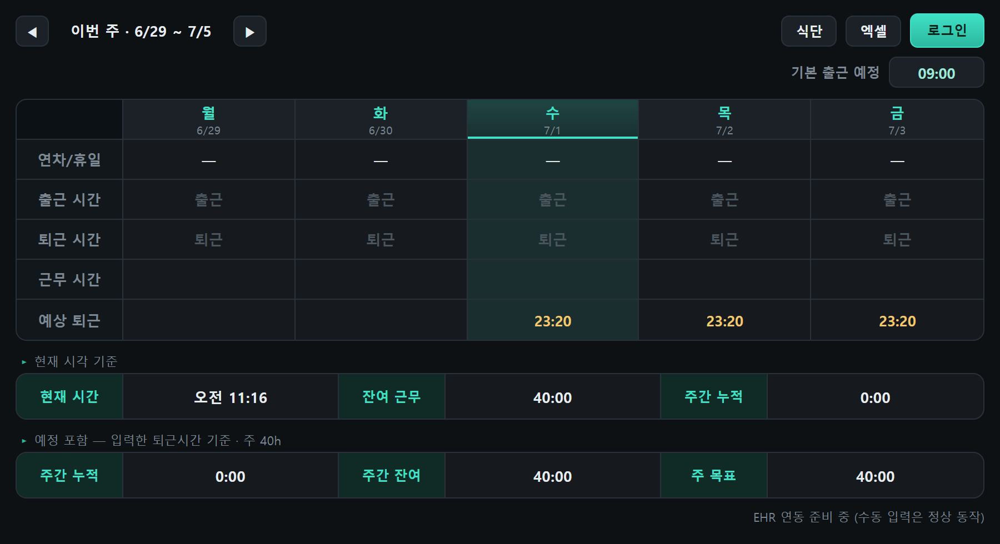
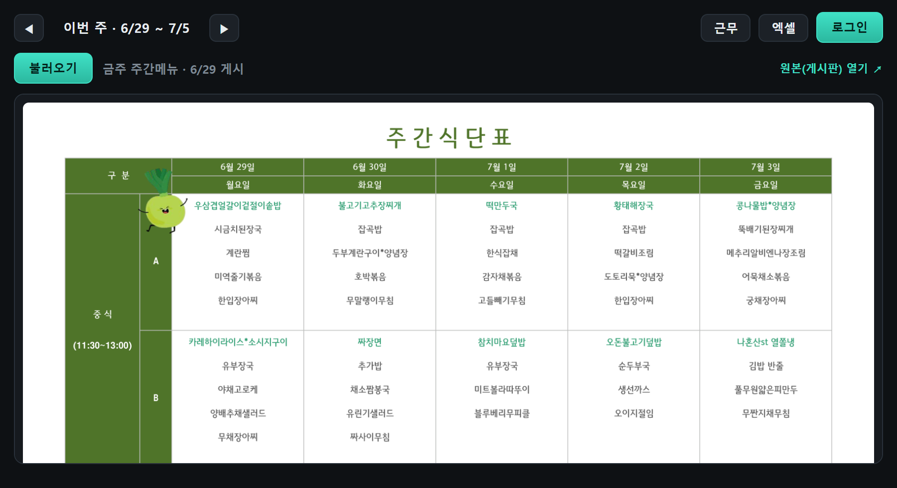
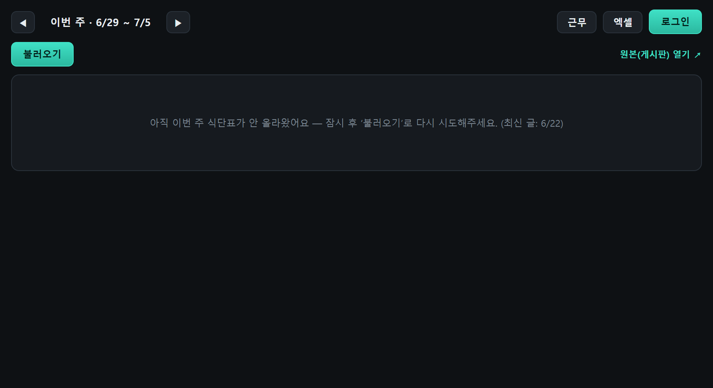

# WorkTimeChecker (근태)

출퇴근 시간을 관리하는 작은 Windows 데스크톱 앱. 회사 그룹웨어(DaouOffice EHR)에서 실제 출퇴근을 자동으로 가져오고, **주 40시간 기준 잔여·연장 시간을 실시간 계산**한다. 트레이에 상주하며, 단일 `.exe` 하나로 배포된다.

## 기능
- 🕒 **실시간 계산** — 출근/퇴근만 넣으면 근무·잔여·연장 자동 (점심 1시간 제외)
- 🔄 **EHR 자동채움** — 앱 켤 때 그룹웨어에서 과거+오늘 출퇴근 자동 입력 (미래는 직접)
- 📊 **주 40시간 기준** — 두 줄 요약: `현재 시각 기준` / `예정 포함(입력한 퇴근시간까지)`, 40h 초과 시 빨간 연장(+)
- 🏖️ **연차 / 반차** — 연차·휴일 8h 인정, 오전/오후 반차(출근·퇴근 13:00 자동 + 4h 인정)
- 📅 **공휴일 자동** — 한국 공휴일(설날·추석·대체공휴일 포함, 오프라인 `holidays` 라이브러리) 자동 8h 인정
- 🍱 **주간식단표** — 좌측 사이드바 `식단` 탭으로 회사 게시판(주간메뉴)의 이번 주 식단표를 앱 안에서 바로 확인 (작성일 최신 1개만 저장, 이전 파일 자동 삭제)
- 🗓️ **캘린더** — 좌측 사이드바 `캘린더` 탭으로 그룹웨어 일정을 월 달력으로 확인. **누구 일정을 볼지 캘린더별 체크박스로 토글**(내 일정 · 전사 · 구독한 동료/팀), 공휴일은 **빨간날**로 표시
- 🖥️ **트레이 상주** — 닫으면 트레이로 숨김, Python 없이 도는 단일 exe로 배포

## 주간식단표 보기

사내 그룹웨어 게시판(주간메뉴)에 올라온 이번 주 식단표를 앱에서 바로 확인한다. 별도 로그인은 필요 없으며, EHR 조회에 사용하는 로그인 세션을 그대로 쓴다.

**사용 방법**

1. 좌측 사이드바의 `식단` 탭을 누른다.

   

2. `불러오기`를 누르면 게시판에서 이번 주 식단표를 가져와 표시한다. 세로로 긴 표는 스크롤로 확인한다. `원본(게시판) 열기`로 원본 게시글을 브라우저에서 열 수 있다.

   

3. 사이드바의 `근태` 탭을 누르면 근무시간 화면으로 돌아간다. 탭 이름은 고정되어 있고, 현재 보고 있는 화면이 강조된다.

**이번 주 식단이 아직 없을 때**

식단표는 보통 해당 주 월요일에 게시되며, 늦어지는 경우가 있다. 이번 주 작성 글이 아직 없으면 지난 주 식단표를 보여주지 않고 아래 안내가 표시된다. 잠시 후 `불러오기`로 다시 시도하면 된다.

   

**동작 방식**

- 게시판(`config.json`의 `mealBoardId`, 기본 `380`)에서 **작성일이 이번 주(월~일) 범위에 드는 최신 글**만 대상으로 한다.
- 내려받은 식단표 이미지는 `%APPDATA%\worktime\meal\`에 **이번 주 것 한 개만** 저장하고 이전 파일은 자동으로 삭제한다.
- 주가 바뀌면 지난 주 저장본은 화면에 표시되지 않는다.

## 캘린더 보기

사이드바 `캘린더` 탭을 누르면 그룹웨어 캘린더 일정을 **월 달력**으로 보여준다. 별도 로그인 없이 EHR 세션(`.ehr_state.json`)을 그대로 쓴다.

- **누구 일정까지 볼지 체크박스로 토글** — 상단 범례에 캘린더별 체크박스(내 일정 · 전사일정 · 휴일 + 내가 구독한 동료/팀 캘린더)가 뜬다. 체크를 끄면 그 캘린더 일정만 즉시 숨긴다(재조회 없음). 선택 상태는 저장돼 다음에도 유지된다.
- **빨간날(공휴일)** — 그룹웨어 휴일 캘린더의 공휴일을 빨간색으로 표시하고, 일요일은 빨강·토요일은 파랑으로 구분한다.
- **월 이동** — `◀ / ▶`로 앞뒤 달, `오늘`로 이번 달. 각 달은 조회 결과를 캐시해 다음 진입 시 즉시 표시한다.
- 일정 칩을 누르면 원본 그룹웨어 캘린더가 기본 브라우저로 열린다.

동작 방식: `/api/calendar/user/{userId}/calendar`(내/전사/휴일) + `/api/calendar/feed`(구독)로 캘린더 목록을, `/api/calendar/event`로 해당 월(일요일 시작 그리드 범위)의 일정을 받아온다. 표시 여부(체크박스)는 프론트에서 거른다.

## 코드 구조
| 경로 | 역할 |
|---|---|
| `app.py` | pywebview 창 + pystray 트레이 + JS 브리지(저장 / EHR / 식단 / 캘린더 / 공휴일). **exe 진입점** |
| `ui/index.html` · `ui/style.css` · `ui/app.js` | 그리드 UI와 **모든 시간 계산 로직**(다크+민트 테마), 식단·캘린더 화면 |
| `ehr.py` | Playwright로 DaouOffice 근태 API를 조회. 로그인 세션은 `.ehr_state.json`에 저장 |
| `meal.py` | DaouOffice 게시판(주간메뉴 board)에서 최신 글의 식단표 이미지를 조회. EHR 세션(`.ehr_state.json`) 재사용, 이미지는 `%APPDATA%\worktime\meal\`에 최신 1개만 |
| `cal.py` | DaouOffice 캘린더 API로 캘린더 목록 + 월 일정을 조회. EHR 세션의 **쿠키만 재사용해 순수 HTTP로 조회(브라우저 안 띄움 → 빠름)**, 월별 캐시는 `%APPDATA%\worktime\calendar\`에 |
| `tools/probe_calendar.py` · `tools/probe_colors.py` | 캘린더 API/색상 팔레트를 실제 브라우저 네트워크 캡처로 발견한 일회성 탐침(재발견용, 배포엔 불필요) |
| `build.ps1` · `build.bat` | PyInstaller로 단일 `dist/WorkTime.exe` 빌드 |
| `requirements.txt` | pywebview, pythonnet, pystray, Pillow, playwright, holidays |

- 입력값/세션 저장: 개발 시 폴더 안(`data.json`·`.ehr_state.json`), exe 배포 시 `%APPDATA%\worktime\`
- 계산: `근무 = (퇴근−출근) − 점심(12:00~13:00 겹치는 만큼)`, 주 목표 40h(`settings.weeklyTarget`)
- TTree API 조사/DDD 문서: [`docs/ttree-api-discovery.md`](docs/ttree-api-discovery.md), [`docs/ttree-ddd-architecture.md`](docs/ttree-ddd-architecture.md)

## 개발 환경
```powershell
python -m venv .venv
.venv\Scripts\python -m pip install -r requirements.txt
.venv\Scripts\pythonw app.py        # 실행 (콘솔 없이)
```

빈 출근 칸에는 **기본 출근 예정**이 옅은 회색으로 표시된다. 퇴근 시간만 입력하면 기본 출근 예정으로 근무·주간 누적·예상 퇴근을 계산하며, 실제 출근을 입력하거나 EHR에서 가져오면 실제 시간이 우선한다. 회색 예정은 출근 기록으로 저장하지 않으며, 출퇴근이 모두 빈 날은 현재 근무에 합산하지 않는다.

시간 요약은 누적(파랑), 잔여(노랑), 하루 목표 이내 잔여(청록), 목표 달성(초록), 연장(빨강)으로 구분하고 주간 진행 막대를 표시한다. 좌측 사이드바의 `근태 · 식단 · 캘린더 · 휴가·출장 · 결재` 탭은 이름을 유지하며 현재 화면을 강조한다. 테마 전환과 EHR 로그인 버튼은 사이드바 하단에 있다.

UI 회귀 확인(설치된 Edge를 사용하고, 개인 데이터나 그룹웨어 연결 없이 실행):
```powershell
.venv\Scripts\python -m unittest discover -s tests -v
```

## TTree 연장근무 신청

`TTree → 신청 종류 → 연장근무 · 이번 주 12시간`에서 사유를 입력하고 미리보기를 확인한다. 기간은 이번 주 월요일~일요일, 시간은 회사 양식의 12시간으로 고정된다. TTree에서 지정한 결재선은 자동 선택하며, 근무 재시작은 해당 옵션을 직접 선택한 경우에만 요청한다.

확인 체크박스와 신청 확인을 거쳐 전송한다. 신청 현황에는 등록일·신청 시간·결재 상태·반려 사유가 표시된다. 이번 주 기존 신청과 TTree 주간 근무시간 제한을 전송 전에 확인한다. 전송 결과가 불확실하면 자동 재시도하지 않으며, 현황을 먼저 새로고침해야 한다. UI를 열거나 미리보기를 누르는 것만으로 신청되지는 않는다.

## exe 빌드 · 배포
- **`build.bat` 더블클릭** → `dist/WorkTime.exe` 생성 (~60MB, 받는 사람은 Python 불필요)
- 받는 사람: exe 실행 → 우측 **로그인** 버튼으로 본인 그룹웨어 1회 로그인 → 이후 자동
- 필요 조건: Windows + **Chrome 또는 Edge**(기본 탑재) + WebView2 런타임(대개 이미 있음)

### 오래 실행한 뒤 EHR 모듈 오류가 날 때

`No module named 'greenlet._greenlet'`은 Windows 임시파일 정리로 실행 중인 exe의 압축 해제 파일이 사라졌을 때도 발생한다. 기존 버전은 트레이에서 **종료**한 뒤 다시 실행하면 복구된다. 수정 버전은 EHR·식단·TTree·결재 작업 프로세스에 `PYINSTALLER_RESET_ENVIRONMENT=1`을 적용해 필요한 파일을 새로 풀어 사용한다. 코드 수정 후에는 exe를 다시 빌드해야 적용된다.

## 설정 (그룹웨어 주소)
회사 그룹웨어 주소는 **`config.json`** 에 넣는다 (개인정보라 저장소엔 `config.example.json`만 포함, 실제 `config.json`은 `.gitignore`).
```powershell
copy config.example.json config.json     # origin 값을 본인 회사 DaouOffice 주소로 수정
```
`build.bat` 가 `config.json` 을 exe에 함께 묶으므로, 빌드 전에 먼저 설정해야 한다.

## EHR 연동 메모 (DaouOffice)
DaouOffice 공통 API를 쓴다:
```
GET /api/user/session                          -> data.id (userId)
GET /api/ehr/timeline/month?baseDate=&userId=  -> weekList[].dailyList[] (clockInTime/clockOutTime)
```
식단표는 게시판(주간메뉴 board) 내부 API를 쓴다 (`config.json` 의 `mealBoardId`, 기본 380):
```
GET /api/board/{id}/posts/classic?page=0&offset=20&sorts=sortCriteria+desc,...  -> data[](작성일 최신순)
GET /api/board/{id}/post/{postId}/classic  -> data.content(본문 HTML, 인라인 ), data.attaches[](PDF 등)
GET {origin}{img src}  -> 식단표 이미지(PNG)
```
캘린더는 캘린더 API를 쓴다:
```
GET /api/calendar/user/{userId}/calendar        -> data[](내 일정·전사·휴일 캘린더)
GET /api/calendar/feed?sort=sequence+asc        -> data[].calendar(내가 구독한 동료/팀 캘린더)
GET /api/calendar/event?timeMin=&timeMax=&includingAttendees=true&calendarIds[]=..
     -> data[](일정; type=holiday 가 공휴일/빨간날, timeType=allday|timed)
```
> 캘린더 API/색상 팔레트는 `/app/calendar` 페이지의 실제 네트워크 요청을 캡처해 발견했다 (`tools/probe_calendar.py`, `tools/probe_colors.py`).
> 캘린더 조회는 근태/식단과 달리 **Playwright 브라우저를 쓰지 않고**, 저장된 세션의 쿠키만 꺼내 `urllib`로 직접 부른다(브라우저 기동 3~5초를 없애 월 이동이 빠르다). 세션 파일은 읽기만 한다.

> 회사 보안정책이 PyInstaller 번들 크롬 실행을 막는 경우가 있어, Playwright는 **시스템에 설치된 Chrome→Edge**(`channel`)를 사용한다.
