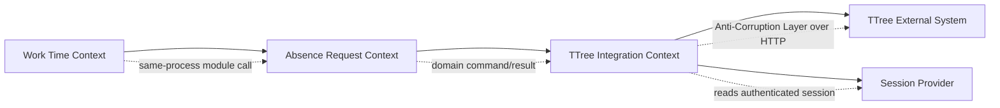

# TTree Leave And Business Trip Integration DDD Architecture

## Purpose

WorkTimeChecker currently calculates and visualizes work time from user input and DaouOffice EHR data. The next capability is to prepare TTree leave and business-trip requests from the same personal work-time context.

The implemented capability supports TTree code lookup, approval-line lookup, application status lookup, payload preview, and real leave/business-trip submission. Lookup and preview flows never call submit endpoints. Real submission is available only through an explicit UI checkbox plus final confirmation dialog.

Discovery details, evidence trail, and repeatable re-check steps are documented in [TTree API Discovery Notes](ttree-api-discovery.md).

## Domain Framing

### Goals

- Let the user prepare a TTree leave or business-trip request from WorkTimeChecker without retyping dates and times.
- Keep the WorkTimeChecker model independent from TTree's API field names and UI concepts.
- Make real submission a deliberate, auditable command, not an accidental side effect of previewing.
- Preserve TTree as the source of truth for approval, validation, duplicate checks, remaining leave, and final persistence.

### Actors

- User: prepares and eventually submits their own leave or business-trip request.
- WorkTimeChecker: creates request drafts from local work-time context.
- TTree: external upstream system that owns leave, business-trip, approval-line, duplicate-check, and request persistence rules.
- Approver: receives the request through TTree's existing approval flow.

### Assumptions

- The user authenticates TTree through WorkTimeChecker's dedicated Playwright login window, and the saved `.ttree_state.json` session is reused for later API calls.
- Approval lines are effectively fixed for this user, but the application should resolve `sanctnId` by approval-line name instead of hard-coding the ID.
- WorkTimeChecker only acts for the signed-in user. It must not expose arbitrary `workUserId` entry.
- TTree server-side validation remains authoritative.

## Subdomains

| Subdomain | Classification | Responsibility |
| --- | --- | --- |
| Work Time Calculation | Core | Calculate daily and weekly work-time status, targets, overtime, leave effects, and UI state. |
| Absence Request Drafting | Supporting | Convert user intent into a leave or business-trip draft and validate local completeness. |
| External TTree Integration | Supporting | Translate WorkTimeChecker drafts into TTree API contracts and call safe lookup or submission endpoints. |
| Authentication Session Reuse | Generic | Reuse browser/Electron session state for authenticated TTree requests. |
| Approval Line Lookup | Supporting | Resolve fixed approval-line names to TTree `sanctnId` values. |

## Bounded Contexts

### Work Time Context

Owns:

- Daily work records displayed in the app.
- Weekly target and remaining/extra time calculations.
- Holiday and half-day interpretation for local planning.

Does not own:

- TTree request IDs.
- TTree leave balances.
- TTree approval-line IDs.
- Final approval or persistence state.

### Absence Request Context

Owns:

- User-facing request intent: leave vs business trip, dates, time range, reason, customer, location.
- Draft lifecycle: created, validated locally, previewed, ready for submission.
- Safety policy: lookup/preview are non-submitting; real submit requires explicit user confirmation in the UI.

Important language:

- Request Draft: local intent before TTree accepts it.
- Request Preview: exact TTree method, URL, body, and warnings, without sending the final submit call.
- Submit Intent: explicit user command to call TTree's state-changing endpoint after preview/confirmation.

### TTree Integration Context

Owns:

- TTree endpoint contracts.
- Translation between WorkTimeChecker value objects and TTree payload fields.
- TTree lookup responses: vacation categories, vacation types, presets, remaining leave, duplicate checks, approval-line IDs.
- Anti-corruption mapping so TTree names such as `vcatnSeCd`, `bsrpBgnDe`, and `sanctnId` do not leak into the Work Time Context.

Does not own:

- Business meaning of WorkTimeChecker's local work-time calculations.
- TTree server-side rules.

## Context Map



Relationship types:

- Work Time Context to Absence Request Context: same-process module call inside the modular monolith.
- Absence Request Context to TTree Integration Context: Anti-Corruption Layer. The request context should use domain names, not TTree field names.
- TTree Integration Context to TTree: conformist at the boundary only. It accepts TTree's API contract but translates it immediately.

## Tactical Model

### Absence Request Aggregate

Aggregate root: `AbsenceRequestDraft`

Identity:

- Local draft ID, or deterministic in-memory ID for preview-only flows.

Value objects:

- `RequestKind`: `Leave` or `BusinessTrip`.
- `DateRange`: start date and end date.
- `TimeRange`: start time and end time, optional for full-day leave.
- `LeaveType`: local display label plus resolved TTree category/type codes.
- `BusinessTripDetail`: type, customer, location, reason.
- `ApprovalLineRef`: approval-line name and resolved `sanctnId`.
- `TTreePayloadPreview`: method, URL, content type, body, warnings.

Invariants:

- Start date must not be after end date.
- Time range must be present for half-day or custom-time requests.
- Leave draft requires leave category, leave type, calculated day count, reason, and approval line.
- Business-trip draft requires business-trip type, date range, time range, reason, and approval line.
- Education-type business trip requires an attachment before real submission.
- Real submission requires the UI confirmation checkbox and final confirmation dialog; status refresh, lookup, and preview must never submit.

Domain events:

- `AbsenceRequestDraftCreated`
- `AbsenceRequestPreviewGenerated`
- `AbsenceRequestSubmissionRequested`
- `AbsenceRequestSubmitted`
- `AbsenceRequestRejectedByTTree`

The current feature can raise preview, submission requested, submitted, and rejected-by-TTree outcomes.

### Domain Services

`AbsenceRequestPolicy`

- Validates local draft completeness.
- Enforces that lookup and preview are non-submitting.
- Allows submission only from the explicit submit command.

`ApprovalLineResolver`

- Uses a configured approval-line name, default `차상위자`.
- Calls TTree lookup and returns the matching `sanctnId`.
- Does not hard-code `sanctnId`.

`TTreePayloadFactory`

- Converts domain drafts into TTree request payloads.
- Keeps TTree field names inside the integration layer.

## TTree Published Contract

These endpoints were discovered from TTree client-side JS cached by Electron. They should be treated as an external, unstable contract and wrapped behind the TTree Integration Context.

### Approval Line

```http
GET /users/sanctn?searchRepUserId={userId}&searchSanctnSe=VCATN
GET /users/sanctn/{sanctnId}
```

Use `sanctnInfoList[].sanctnInfo.sanctnId` where `sanctnNm` matches the configured approval-line name.

### Leave Lookup And Validation

```http
POST /vcatn/cl/get
POST /vcatn/se/get
GET  /work/preset/user
GET  /vcatn/fileYnChk
GET  /vcatn/worktime/except
POST /vcatn/usedaylist/get
POST /vcatn/duple
```

Important notes:

- `POST /vcatn/se/get` receives JSON text like `{"vcatnClCd":"..."}`.
- `GET /vcatn/worktime/except` calculates leave minutes and day count.
- `POST /vcatn/duple` checks duplicate leave, overtime, or business-trip data before submit.

### Leave Submit

State-changing endpoint. Called only by the explicit leave submit command after UI confirmation.

```http
POST /vcatn
Content-Type: application/json
```

Payload shape:

```json
{
  "vcatnBgnDe": "2026-07-01",
  "vcatnEndDe": "2026-07-01",
  "vcatnBgnTime": "080000",
  "vcatnEndTime": "120000",
  "vcatnTimeMnt": "240",
  "vcatnClCd": "...",
  "vcatnSeCd": "...",
  "vcatnCn": "reason",
  "vcatnDayCnt": "0.5",
  "workUserId": "...",
  "sanctnId": "...",
  "atchFileId": "",
  "maternitySplitYn": "N",
  "maternitySplitCnt": ""
}
```

### Business Trip Validation

```http
GET /work/bsrp/duplechk?searchBgnDe=YYYYMMDD&searchEndDe=YYYYMMDD&searchBgnTime=HHmmss&searchEndTime=HHmmss
```

### Business Trip Submit

State-changing endpoint. Called only by the explicit leave submit command after UI confirmation.

```http
POST /work/bsrp
Content-Type: application/x-www-form-urlencoded; charset=UTF-8
```

Payload shape:

```json
{
  "bsrpBgnDe": "20260701",
  "bsrpEndDe": "20260701",
  "bsrpBgnTime": "080000",
  "bsrpEndTime": "170000",
  "bsrpType": "bsrp",
  "bsrpCn": "reason",
  "customer": "customer name",
  "location": "location",
  "sanctnId": "...",
  "atchFileId": ""
}
```

`bsrpType` values:

- `bsrp`: business trip
- `edu`: education, attachment required by TTree client rules

## Application Flows

### Leave Preview Flow

1. User chooses leave dates, range, and reason.
2. Application resolves current TTree user/session.
3. TTree Integration loads leave categories and leave types.
4. Application resolves fixed approval line by name.
5. TTree Integration calculates effective leave minutes/day count.
6. TTree Integration checks duplicate state.
7. Application returns a preview with method, URL, body, and warnings.
8. No submit endpoint is called.

### Business Trip Preview Flow

1. User chooses business-trip date, time range, reason, customer, and location.
2. Application resolves fixed approval line by name.
3. TTree Integration performs duplicate check.
4. Application returns a preview with method, URL, form body, and warnings.
5. No submit endpoint is called.

### Real Submission Flow

1. Generate preview.
2. Require an explicit final confirmation on the exact payload summary.
3. Check `ttree.submit.enabled == true`.
4. Call only the matching submit endpoint.
5. Store TTree response metadata, not raw cookies or secrets.
6. Refresh WorkTimeChecker state from TTree or EHR after submit.

## Architecture Mapping

Default to a modular monolith with package-by-context boundaries:

```text
worktime/
  domain/
  application/
  infrastructure/
absence_request/
  domain/
  application/
  interfaces/
ttree_integration/
  application/
  infrastructure/
  acl/
```

Suggested files for this repository:

```text
ttree.py                         # infrastructure adapter and CLI-style safe probes
ttree.py                         # TTree adapter, lookup, preview, and submit command handlers
app.py                           # pywebview bridge methods
ui/app.js                        # TTree status, preview, and confirmed submit UI
ui/index.html                    # request/status panel
ui/style.css                     # preview styling
```

Dependency direction:

- `absence_request` may define ports such as `ApprovalLinePort` and `TTreeRequestPreviewPort`.
- `ttree_integration` implements those ports.
- `app.py` coordinates use cases and exposes them to the UI.
- UI must not construct TTree payload fields directly.

## Safety Requirements

- Submit endpoints must never be called by login, lookup, status refresh, or preview flows.
- `POST /vcatn` and `POST /work/bsrp` are called only by explicit submit methods after user confirmation.
- Preview mode may build the exact payload, but it must not submit it.
- Do not read or print raw cookies.
- Do not allow the UI to override `workUserId`; derive it from the authenticated session.
- Store only minimal non-secret metadata in logs.
- Treat TTree response errors as authoritative and show them without retry storms.

## Open Questions

- Can the Playwright login flow be made more reliable if TTree changes its login form or requires tenant-specific hidden fields?
- Which approval-line name should be configured for each request type: `차상위자` only, or `차상위자 - 최고관리자` for education and holiday business trips?
- Should attachments be supported in the first real submission release?
- Should WorkTimeChecker store local drafts, or only generate transient previews?
- Does TTree accept date strings with dashes for leave submit in all cases, or should the integration normalize to the exact UI format per endpoint?

## Recommended Implementation Plan

1. Implemented `ttree.py` adapter for session check, status lookup, approval-line lookup, leave code lookup, preview payloads, duplicate checks, and confirmed submit.
2. Implemented pywebview bridge methods in `app.py`.
3. Implemented TTree UI panel in `ui/index.html`, `ui/app.js`, and `ui/style.css`.
4. Keep adding focused tests around payload mapping and submit guards as the module evolves.
5. Add attachment support later for request types that require files, especially education-type business trips.
